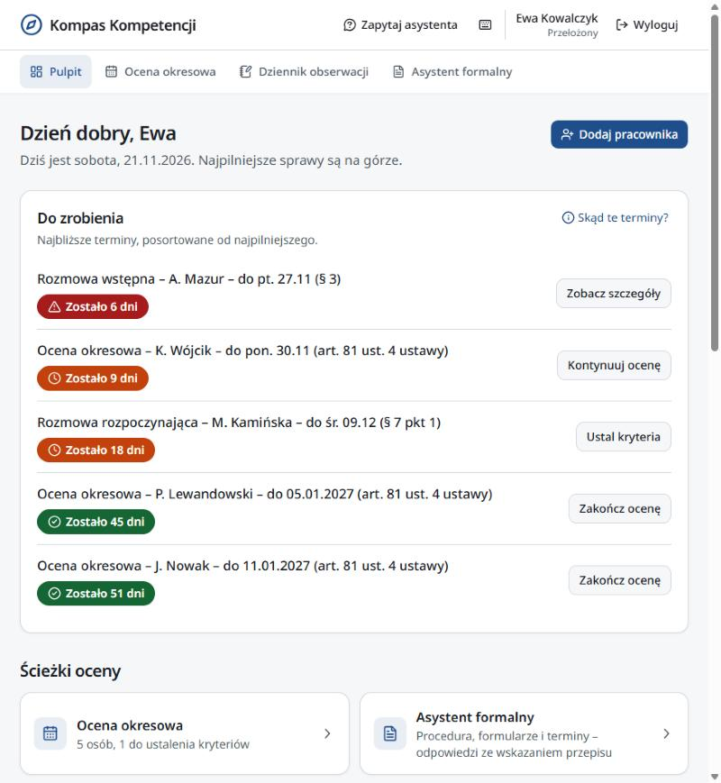
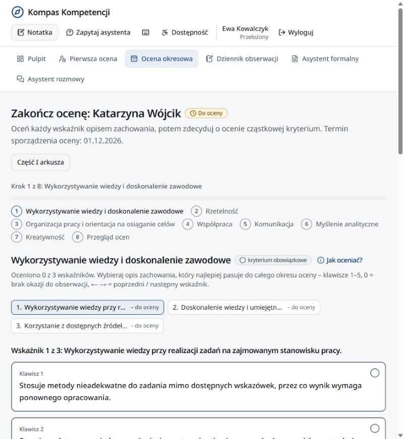
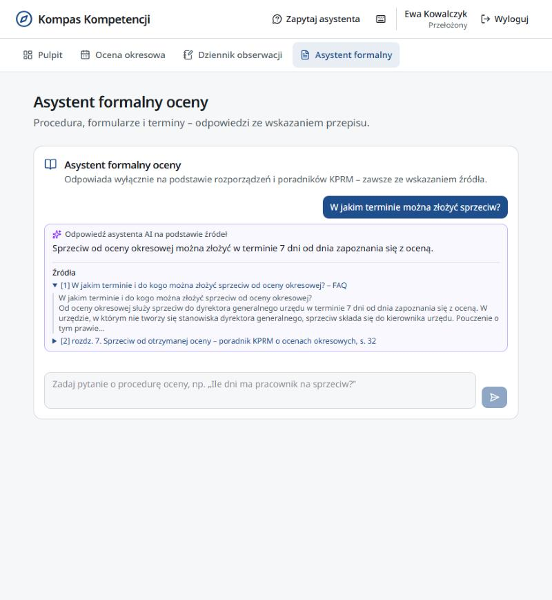

# Kompas Kompetencji · sprawdz.my.kompetencje

**Ocena oparta na zachowaniach, nie na wrażeniach.**

Kompas Kompetencji prowadzi przełożonego w służbie cywilnej krok po kroku przez ocenę okresową (arkusze B i C), a przy pierwszej ocenie pilnuje terminów i odpowiada na pytania o procedurę: od opisu stanowiska pracy, przez wybór kryteriów i dziennik obserwacji, po ocenę opartą na **49 wskaźnikach behawioralnych** modelu kompetencji. System proponuje poziom kompetencji i pokazuje, skąd się wziął, ale **decyzję zawsze podejmuje przełożony**. Punkty, wynik i terminy liczy kod zgodnie z rozporządzeniami, a asystent AI odpowiada na pytania o procedurę **wyłącznie na podstawie przepisów i poradników KPRM, zawsze ze wskazaniem źródła**.

Rozwiązanie zadania Ministerstwa Cyfryzacji (Biuro Dyrektora Generalnego) „Kompas Kompetencji” – HackNation 2026.

## Demo

**https://sprawdz-my-kompetencje.vercel.app** – logowanie jednym kliknięciem na karcie konta demo (dane są fikcyjne).

| Rola | E-mail | Hasło | Co zobaczyć |
|---|---|---|---|
| **Przełożona – Ewa Kowalczyk** | `ewa.kowalczyk@demo.kompas.test` | `Kompas2026!` | pulpit „Do zrobienia”, ocena okresowa, dziennik obserwacji i szybka notatka, asystent rozmowy, asystent formalny |
| HR / administrator | `hr@demo.kompas.test` | `Kompas2026!` | panel HR: terminy z wydłużeniami, przypomnienia, Lustro ocen, dziennik decyzji z eksportem CSV, reset danych demo |
| Oceniany – Jan Nowak | `jan.nowak@demo.kompas.test` | `Kompas2026!` | własne oceny i potwierdzenie zapoznania się; rola z najwęższymi uprawnieniami – próba wejścia na ekrany przełożonego albo do API wraca na własny ekran / 403 |
| Kierujący komórką | `kierujacy@demo.kompas.test` | `Kompas2026!` | pierwsze oceny nowych pracowników komórki: etap, kalendarz terminów i jego rola (art. 38 ustawy); asystent formalny |

Scenariusz krok po kroku dla jury (ok. 12 minut): **[`docs/DEMO.md`](docs/DEMO.md)**.

## Dla jury

### Sprawdzenie w 5 minut

1. **„Zaloguj jako Ewa Kowalczyk”** – pulpit z terminami liczonymi z przepisów.
2. **„Kontynuuj ocenę”** przy Katarzynie Wójcik – przy każdym wskaźniku wybierz opis zachowania (klawisze 1–5, strzałki – następny wskaźnik). Po ocenie wskaźników system pokazuje **sugerowany poziom** z wyjaśnieniem „Dlaczego ten poziom?”, a **decyzję podejmuje przełożona** (inna niż sugestia wymaga jednego zdania powodu).
3. **Podsumowanie** – wynik według § 11 z wyjaśnieniem, uzasadnienie, wnioski do IPRZ, arkusz **PDF** według wzoru z rozporządzenia.
4. **Asystent formalny** (klawisz `/`) – zadaj pytanie o pierwszą ocenę albo ocenę okresową; odpowiedź ze źródłem, a poza zakresem uczciwa odmowa.
5. **Asystent rozmowy** – ściąga do rozmowy z pracownikiem: pytania, kwestie do omówienia, argumenty z notatek; tryb „5 minut przed rozmową”.
6. Wyloguj → **HR**: statusy i terminy wszystkich ocen, przypomnienia, dziennik decyzji AI i człowieka.

### Wymagania zadania – gdzie je zobaczyć

| Wymaganie z treści zadania | Gdzie w rozwiązaniu |
|---|---|
| Działający prototyp, ścieżka przełożonego | demo powyżej; ocena okresowa (arkusze B i C) i pierwsza ocena – dwie odrębne ścieżki krok po kroku |
| Model kompetencji ze wskaźnikami i opisami poziomów | 49 wskaźników z `materialy/Model_kompetencji.xlsx`; ocena przez wybór zachowania, sugestia poziomu, decyzja przełożonego |
| Dobór kryteriów | arkusz B/C wybierany z opisu stanowiska (§ 3), kryteria obowiązkowe z rozporządzenia, do 3 dodatkowych z propozycją AI i cytatem z OSP |
| Dokumentacja i formularze, PDF | część I i pełny arkusz oceny okresowej, arkusz pierwszej oceny – według wzorów z rozporządzeń |
| Terminy i komunikacja | silnik terminów (ustawa, rozporządzenia, KC, święta, nieobecności), przypomnienia z panelu HR, ekran kierującego komórką, zawiadomienie o zmianie terminu |
| Asystent AI: przepisy i przygotowanie do rozmowy | asystent formalny ze źródłami i odmową; asystent rozmowy, tryb rozmowy, „5 minut przed rozmową” – [`docs/AI.md`](docs/AI.md) |
| AI tylko doradza | każda propozycja AI oznaczona, do decyzji człowieka, zapisana w dzienniku decyzji; punkty i wynik liczy kod, nie model |
| Perspektywa HR / administratora | panel HR: statusy, terminy, przypomnienia, Lustro ocen, dziennik decyzji z CSV, przepisy i model bez zmian w kodzie |
| Integracje (EZD, systemy kadrowe), API | REST API `/api/v1` – [`docs/openapi.yaml`](docs/openapi.yaml) |
| Uwierzytelnianie, role, ochrona danych | 4 role, autoryzacja w każdym API i akcji, pseudonimizacja przed modelem, minimalizacja danych – [`docs/BEZPIECZENSTWO.md`](docs/BEZPIECZENSTWO.md) |
| Technologie i architektura, rozwój i wdrożenie | [`docs/ARCHITEKTURA.md`](docs/ARCHITEKTURA.md), lista prac przed produkcją w [`docs/AI.md`](docs/AI.md) i [`docs/BEZPIECZENSTWO.md`](docs/BEZPIECZENSTWO.md) |
| Darmowe narzędzia AI | demo na darmowym planie Gemini; docelowo model lokalny (Ollama: Bielik, PLLuM) – bez zmian w kodzie |
| Czytelny interfejs w przeglądarce | WCAG 2.1 AA, ustawienia dostępności (tekst, kontrast, tryb ciemny), [deklaracja dostępności](https://sprawdz-my-kompetencje.vercel.app/deklaracja-dostepnosci) |

### Jakość

- **873 testy automatyczne** (Vitest) – silnik reguł, terminy, punktacja, uprawnienia, AI; testy end-to-end w przeglądarce (Playwright) z kontrolą dostępności axe.
- Asystent formalny: **25/25 trafnych odpowiedzi ze źródłem i 5/5 poprawnych odmów** w zestawie testowym – [`eval/wynik.md`](eval/wynik.md).
- Pełna ocena okresowa (7 kryteriów, 25 wskaźników) w kilka minut – pomiar w [`docs/UX.md`](docs/UX.md).



## Najważniejsze funkcje

| | Funkcja | Jak działa |
|---|---|---|
| 🗂 | **Pulpit „Do zrobienia”** | najpilniejsze sprawy z terminami liczonymi z przepisów (art. 81 ustawy, § 7, KC 112/115, święta), kolor + tekst pilności, jeden przycisk akcji; przypomnienie o osobach bez notatki od ponad 3 miesięcy z przyciskiem „Dodaj notatkę” |
| 📄 | **Opis stanowiska → arkusz** | wgranie OSP (.docx) – system odczytuje cel, zadania i liczbę podległych i sam wybiera arkusz B lub C z wyjaśnieniem (§ 3) |
| ✨ | **Kryteria dodatkowe z OSP** | AI proponuje do 3 kryteriów z uzasadnieniem i **dosłownym cytatem zadania z OSP**; kod sprawdza listę, limit i cytat; przełożony wstawia albo odrzuca |
| 📝 | **Dziennik obserwacji (SDR)** | notatki Sytuacja – Działanie – Rezultat przypięte do wskaźnika, przez cały okres oceny |
| ⚡ | **Szybka notatka w 10 sekund** | klawisz `N` i jedno zdanie – AI proponuje pracownika, wskaźnik, SDR i poziom zachowania; imiona nie trafiają do modelu (pseudonimizacja); przełożony poprawia i zapisuje |
| 🃏 | **Ocena przez wybór zachowania** | przy każdym wskaźniku 5 opisów zachowań z modelu MC (bez liczb) + „brak okazji do obserwacji”, obok notatki z dziennika; klawisze 1–5 |
| 🧭 | **„Dlaczego ten poziom?”** | sugerowany poziom kryterium z rozkładem wyborów, wzorem i ostrzeżeniami; zmiana sugestii wymaga jednego zdania powodu – oba wpisy trafiają do dziennika decyzji |
| ⚖️ | **Wynik zgodny z § 11** | średnia, poziom ogólny, wynik pozytywny/negatywny z wyjaśnieniem i podstawą prawną; uzasadnienie obowiązkowe przy ocenie negatywnej, IPRZ, część III, termin sprzeciwu |
| 🗣 | **Asystent rozmowy** | ściąga do rozmowy wstępnej, rozpoczynającej i oceniającej: zakres z przepisu, agenda, mocne strony i obszary do rozwoju z ocen i notatek, pytania, informacja zwrotna zachowanie–skutek–oczekiwanie, działania rozwojowe; do wydruku. Tryb **„5 minut przed rozmową”**: jedna strona – fakty, zdanie na otwarcie, 3 pytania i 3 pułapki (także sygnały Lustra z danych). AI tylko redaguje otwarcie i informację zwrotną |
| 💬 | **Asystent formalny** | odpowiedzi tylko z 411 fragmentów przepisów i poradników, zawsze ze źródłem; uczciwa odmowa poza zakresem; **25/25 trafnych, 5/5 odmów** w zestawie testowym |
| 🏛 | **Panel HR** | wszystkie oceny z terminami i wydłużeniami (np. „+44 dni: zwolnienie lekarskie”), przypomnienia, wzór zawiadomienia o zmianie terminu, ostrzeżenie z art. 71 |
| 🪞 | **Lustro oceniającego** | łagodne sygnały typowych błędów oceniania przed sporządzeniem oceny (efekt świeżości, aureoli, poziom skrajny bez notatki); w panelu HR zanonimizowany rozkład ocen w komórkach (od 3 ocen) i odstający przełożeni |
| 🧾 | **Dziennik decyzji** | każda propozycja AI obok decyzji człowieka, zmiany sugestii i arkusza, sporządzenie i zapoznanie – z filtrami i eksportem CSV (Excel, polskie znaki) |
| 🧑‍💼 | **Kierujący komórką** | pierwsze oceny nowych pracowników komórki z kalendarzem terminów i opisem roli kierującego (porozumienie, rozmowa, podpis, wniosek do dyrektora generalnego) |
| 🔌 | **REST API** | eksport oceny w JSON pod EZD i system kadrowy (`/api/v1/oceny/{id}`), lista ocen i pracowników z tymi samymi uprawnieniami co ekrany – [`docs/openapi.yaml`](docs/openapi.yaml) |
| 👤 | **Moje oceny (oceniany)** | pracownik widzi kryteria i termin bieżącej oceny (część I arkusza), a po sporządzeniu – wynik z wyjaśnieniem, uzasadnienie, IPRZ i termin sprzeciwu; sam potwierdza zapoznanie się z oceną |
| ♿ | **Dostępność** | WCAG 2.1 AA (0 naruszeń axe na ekranach ścieżki demo), przycisk „Dostępność” w nagłówku: większy tekst (125%, 150%), wysoki kontrast i motyw jasny / ciemny / jak w systemie, zapamiętane w przeglądarce; [deklaracja dostępności](https://sprawdz-my-kompetencje.vercel.app/deklaracja-dostepnosci) zgodna z ustawą o dostępności cyfrowej |
| 🔐 | **Role i bezpieczeństwo** | przełożony, HR, oceniany, kierujący; autoryzacja w każdym API i akcji serwerowej (401/403), przełożony widzi wyłącznie swoich podwładnych |

|  |  |
|---|---|
| Ocena wskaźników opisami zachowań z modelu MC | Asystent formalny – odpowiedź z przepisu i źródła |

## Zasady projektu

1. **Przepisy liczy kod, nie model językowy.** Wybór arkusza, punkty, średnie, wynik i terminy to deterministyczne funkcje z testami (`src/lib/rules/`), z parametrami w `data/przepisy.json` – HR zmienia je w panelu „Przepisy i model” bez zmian w kodzie, tak samo jak opisy zachowań z modelu kompetencji.
2. **AI nigdy nie ustala oceny.** Każda propozycja AI jest oznaczona, edytowalna i wymaga decyzji człowieka; decyzje trafiają do dziennika.
3. **Aplikacja działa także bez AI.** Brak modelu albo jego błąd nie blokuje żadnego kroku – asystent pokazuje wtedy pasujące fragmenty przepisów.
4. **Zmiana modelu bez zmiany kodu.** Jeden interfejs zgodny z API OpenAI: lokalnie Ollama (np. Bielik, PLLuM – dane nie wychodzą z urzędu), na demo darmowy Gemini.

## Dokumentacja

| Dokument | Zawartość |
|---|---|
| [`docs/DEMO.md`](docs/DEMO.md) | scenariusz demo krok po kroku |
| [`docs/ARCHITEKTURA.md`](docs/ARCHITEKTURA.md) | architektura, model danych, API, wdrożenie i skalowanie, opis modułów |
| [`docs/AI.md`](docs/AI.md) | gdzie jest AI, a gdzie celowo go nie ma; model; ograniczanie halucynacji; wynik testu asystenta; dane |
| [`docs/BEZPIECZENSTWO.md`](docs/BEZPIECZENSTWO.md) | uwierzytelnianie, role, ochrona danych, zabezpieczenia AI, przygotowanie do produkcji |
| [`docs/UX.md`](docs/UX.md) | zasady UX, komponenty, skróty klawiaturowe, przegląd dostępności (WCAG 2.1 AA) |
| [`docs/openapi.yaml`](docs/openapi.yaml) | specyfikacja REST API: eksport oceny w JSON, lista ocen i pracowników, asystent (pod EZD i system kadrowy) |
| [`docs/WDROZENIE.md`](docs/WDROZENIE.md) | wdrożenie publicznego demo (Vercel + Neon) |
| [`docs/LICENCJE.md`](docs/LICENCJE.md) | licencje zależności (wyłącznie permisywne) |
| [`docs/ZALOZENIA.md`](docs/ZALOZENIA.md) | założenia interpretacyjne tam, gdzie przepisy nie rozstrzygają |

## Technologie

Next.js 15 (App Router) i TypeScript · Tailwind CSS 4 i shadcn/ui · PostgreSQL i Prisma 6 · Auth.js (next-auth v5) · zod · MiniSearch (BM25) · Vitest. Szczegóły i uzasadnienie wyborów: [`docs/ARCHITEKTURA.md`](docs/ARCHITEKTURA.md).

## Uruchomienie lokalne

Wymagania: Node.js 20+ i PostgreSQL (najprościej Docker).

1. `npm install`
2. `cp .env.example .env` (Windows: `copy .env.example .env`) i ustaw `AUTH_SECRET` (dowolny losowy ciąg, np. `npx auth secret`)
3. `npm run db:up` – PostgreSQL w Dockerze (albo własny serwer i `DATABASE_URL` w `.env`)
4. `npm run db:migrate` i `npm run seed` – schemat bazy, konta i dane demo
5. `npm run dev` – aplikacja pod http://localhost:3000

Model AI jest opcjonalny: bez `LLM_BASE_URL` i `LLM_MODEL` aplikacja działa w trybie bez AI. Przykłady konfiguracji (Ollama, Gemini, Groq) są w `.env.example`.

### Dane demo

`npm run seed` tworzy konta i dane wokół persony przełożonej (osoby fikcyjne, stanowiska z OSP dostarczonych przez MC). Daty liczone są od dnia uruchomienia, więc terminy są zawsze aktualne; seed można uruchamiać wielokrotnie. Na produkcji `DEMO_MODE="false"` wyłącza karty kont demo i reset danych.

| Osoba | Stanowisko | Scenariusz |
|---|---|---|
| Katarzyna Wójcik | radca (arkusz C) | ocena za kilka dni, 10 obserwacji w dzienniku – główna ścieżka oceny wskaźników |
| Piotr Lewandowski | naczelnik wydziału (arkusz B) | okres oceny, kryteria dodatkowe z OSP; od ponad 3 miesięcy bez notatki – przypomnienie na pulpicie |
| Jan Nowak (konto ocenianego) | starszy specjalista (arkusz C) | L4 44 dni wydłuża termin; większość notatek z ostatniego miesiąca |
| Marcin Wróbel | starszy specjalista (arkusz C) | wcześniej ocena pozytywna, potem negatywna – ponowna ocena po 6 miesiącach |
| Aleksandra Mazur | starszy specjalista | nowa pracownica – pierwsza ocena, rozmowa wstępna w 21 dni; widoczna też u kierującego komórką |
| Marta Kamińska | radca (arkusz C) | zatrudniona na czas nieokreślony – ocena do rozpoczęcia od OSP |
| Joanna Lewandowska | starszy specjalista | pierwsza ocena po sprawozdaniu i egzaminie – ocena pięciu elementów i wynik |

### Skrypty

| Polecenie | Co robi |
|---|---|
| `npm run dev` / `npm run build` | serwer deweloperski / build produkcyjny |
| `npm test` | testy (Vitest); testy na bazie danych uruchamia `TEST_DATABASE_URL` |
| `npm run e2e` | testy end-to-end w przeglądarce (Playwright): role, ekrany przy 768 i 1440 px z axe (WCAG 2.1 A/AA), tryb rozmowy, pełna ocena okresowa z PDF; przed testami seed danych demo; raport: `npm run e2e:raport`. Pierwszy raz: `npx playwright install chromium` |
| `npm run typecheck` / `npm run lint` | kontrola typów / lint |
| `npm run seed` | konta i dane demo |
| `npm run eval` | zestaw testowy asystenta formalnego (`-- --bez-ai`: tylko wyszukiwanie); wynik w `eval/wynik.md` |
| `npm run eval:notatki` | szybka notatka: czy 5 przykładowych zdań trafia w sensowny wskaźnik (wymaga modelu); wynik w `eval/notatki-wynik.md` |
| `npm run wiedza` | buduje bazę wiedzy asystenta z PDF-ów (`data/wiedza/fragmenty.json`) |
| `npm run model` | import modelu kompetencji `materialy/Model_kompetencji.xlsx` → `data/model-kompetencji.json` |
| `npm run osp -- plik.docx` | podgląd importu opisu stanowiska pracy i wybranego arkusza |
| `npm run db:up` / `db:migrate` / `db:generate` | baza danych: start, migracje, klient Prisma |

## Struktura repozytorium

```
materialy/   materiały od organizatora (rozporządzenia, poradniki KPRM, arkusze, model kompetencji, OSP)
data/        model kompetencji (JSON), parametry przepisów, baza wiedzy asystenta, zapasowe odpowiedzi demo
prisma/      schemat bazy, migracje, seed i dane demo
src/app/     ekrany według ról i API
src/lib/     silnik reguł, import, AI, autoryzacja, logika ekranów
tests/       testy (Vitest)
e2e/         testy end-to-end (Playwright)
eval/        zestaw testowy asystenta i wynik
docs/        dokumentacja
```

## Materiały źródłowe i licencje

- Pliki w `materialy/` pochodzą od organizatora zadania (Ministerstwo Cyfryzacji) i zostały udostępnione na potrzeby hackathonu: rozporządzenie Prezesa Rady Ministrów z 4.04.2016 r. w sprawie ocen okresowych (Dz.U. 2016 poz. 470), rozporządzenie Prezesa Rady Ministrów z 23.07.2015 r. w sprawie pierwszej oceny (Dz.U. 2015 poz. 1144), poradniki Departamentu Służby Cywilnej KPRM (wrzesień 2016), wzory arkuszy, model kompetencji i przykładowe opisy stanowisk pracy.
- Baza wiedzy asystenta to fragmenty tych dokumentów z oznaczeniem źródła (dokument, jednostka redakcyjna, strona).
- Zależności – wyłącznie licencje permisywne (MIT, Apache-2.0, BSD, ISC; czcionki Open Sans i Noto Sans – OFL): [`docs/LICENCJE.md`](docs/LICENCJE.md).
- Wszystkie osoby w danych demo są fikcyjne.
