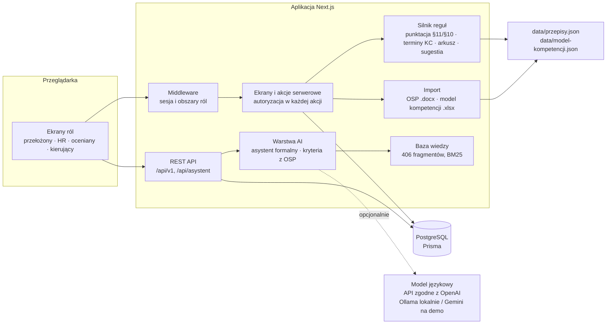
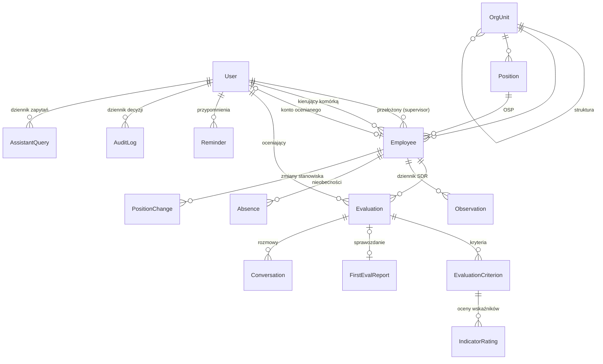

# Architektura

Kompas Kompetencji to jedna aplikacja webowa (Next.js) z interfejsem i API, bazą PostgreSQL i wymiennym modelem językowym. Logika przepisów jest oddzielona od interfejsu i od AI: to czyste funkcje TypeScript z testami, sterowane parametrami z `data/przepisy.json`.

## Przegląd



- **Ekrany i akcje serwerowe** (App Router) dla czterech ról. Middleware kieruje niezalogowanych na logowanie, a każda akcja i każdy handler API sprawdza rolę i zakres danych sam.
- **Silnik reguł** (`src/lib/rules/`) liczy arkusz, punkty, poziom ogólny, wynik, sugerowany poziom i wszystkie terminy. Nie korzysta z AI.
- **Warstwa AI** (`src/lib/ai/`) ma jeden interfejs dostawcy zgodny z API OpenAI. Gdy modelu nie ma albo zawiedzie, funkcje AI przechodzą w tryb bez AI (źródła albo propozycja deterministyczna). Szczegóły: [`AI.md`](AI.md).
- **Baza danych** przechowuje pracowników, stanowiska (OSP), oceny, oceny wskaźników, obserwacje, rozmowy, nieobecności, przypomnienia, dziennik decyzji i dziennik zapytań asystenta.

## Model danych



| Model | Rola |
|---|---|
| `User` | konto z rolą (`PRZELOZONY`, `HR`, `OCENIANY`, `KIERUJACY_KOMORKA`), hasło jako skrót bcrypt |
| `OrgUnit`, `Position`, `Employee` | struktura urzędu, opis stanowiska pracy (pola z OSP + pełny tekst), kartoteka pracownika z przełożonym i kierującym komórką |
| `Evaluation` | ocena okresowa albo pierwsza: arkusz, etap, okres, termin, wynik, poziom ogólny, średnia, uzasadnienie, IPRZ, dane poprzedniej oceny, część III, stan kreatora (autozapis) |
| `EvaluationCriterion`, `IndicatorRating` | kryterium (obowiązkowe/dodatkowe, z uzasadnieniem wyboru), ocena cząstkowa przełożonego, sugestia systemu i powód zmiany; wybór opisu zachowania przy wskaźniku (1–5 albo „brak okazji do obserwacji”) |
| `Observation` | dziennik obserwacji: data, wskaźnik, Sytuacja – Działanie – Rezultat, źródło (ręczna / szybka notatka) |
| `Conversation`, `FirstEvalReport` | rozmowy (wstępna, rozpoczynająca, oceniająca, bieżąca) i sprawozdanie do pierwszej oceny |
| `Absence`, `PositionChange`, `Reminder` | wejście silnika terminów i przypomnienia |
| `AuditLog`, `AssistantQuery` | dziennik decyzji (propozycja AI obok decyzji człowieka, zmiany sugestii, arkusza, przepisów) i dziennik zapytań asystenta |

Typy domeny i wartości wyliczeniowe są w `src/lib/domain/types.ts`; test pilnuje ich zgodności ze schematem Prisma.

## API

Pełna specyfikacja: [`openapi.yaml`](openapi.yaml). Każdy endpoint (poza statusem) wymaga sesji; bez sesji – 401, przy złej roli – 403, z komunikatem po polsku.

| Metoda i ścieżka | Role | Opis |
|---|---|---|
| `GET /api/v1/status` | publiczny | kontrola działania (monitoring wdrożenia) |
| `GET /api/v1/me` | zalogowany | dane zalogowanego użytkownika i rola |
| `GET /api/v1/pracownicy` | przełożony, HR | lista pracowników; przełożony – tylko własni podwładni |
| `GET /api/v1/oceny` | HR, przełożony, oceniany | lista ocen z filtrami (`status`, `typ`, `pracownikId`); HR – wszystkie, przełożony – podwładnych, oceniany – własne sporządzone |
| `GET /api/v1/oceny/{id}` | HR, przełożony, oceniany | **eksport oceny w JSON** pod EZD i system kadrowy; ocena spoza zakresu = 404 |
| `GET /api/asystent/formalny?krok=…` | przełożony, HR, kierujący | podpowiedzi pytań dla kroku ścieżki, dostępność modelu |
| `POST /api/asystent/formalny` | przełożony, HR, kierujący | pytanie → odpowiedź ze źródłami albo odmowa |
| `POST /api/asystent/kryteria` | przełożony, HR | propozycja kryteriów dodatkowych z OSP (plik albo pracownik z bazy) |

Ekrany zapisują dane akcjami serwerowymi Next.js (z walidacją zod i autoryzacją w każdej akcji). Integracja z EZD i systemem kadrowym (np. QNT): eksport oceny w JSON działa (`/api/v1/oceny/{id}`); arkusz B / C w PDF działa (`/api/v1/oceny/{id}/pdf`, Z16); import pracowników i OSP z systemu kadrowego jest opisany w specyfikacji jako planowany.

## Wdrożenie i skalowanie

| Środowisko | Jak |
|---|---|
| **Lokalnie** | `docker compose up` (PostgreSQL 16) + `npm run dev`; model opcjonalny (Ollama) |
| **Demo** | Vercel (aplikacja, region Frankfurt) + Neon (PostgreSQL, Frankfurt) + Gemini (darmowy plan) – [`WDROZENIE.md`](WDROZENIE.md). Wdrażana jest tylko gałąź `main` (stosuje migracje i odtwarza dane demo); inne gałęzie Vercel pomija |
| **Docelowo w urzędzie** | kontener Node.js (`npm run build && npm start`) za reverse proxy z TLS, PostgreSQL urzędu, model lokalny przez Ollamę na serwerze z GPU (np. Bielik) – dane nie opuszczają infrastruktury urzędu |

Skalowanie:
- **Aplikacja jest bezstanowa** (sesja JWT w ciasteczku), więc skaluje się poziomo – kolejne instancje za load balancerem. Jedyny stan w pamięci to limit zapytań do AI; przy wielu instancjach trzeba go przenieść do Redis.
- **Baza:** obciążenie jest małe (kilkadziesiąt ocen na przełożonego co 2 lata); indeksy na przełożonym, ocenianym i etapie oceny. Pula połączeń (np. PgBouncer / pooler Neon).
- **Model:** jedyny element kosztowny obliczeniowo. Wyszukiwanie BM25 działa w procesie aplikacji (406 fragmentów, milisekundy); do modelu trafia tylko 5 fragmentów i pytanie. Odmowa poza zakresem nie woła modelu.
- **Wiele urzędów:** parametry przepisów i model kompetencji są danymi (`data/`), a struktura (`OrgUnit`) – drzewem, więc ta sama aplikacja obsłuży inny urząd po imporcie jego struktury i OSP.

## Stos technologiczny

| Warstwa | Technologia |
|---|---|
| Aplikacja (interfejs + API) | Next.js 15 (App Router), TypeScript w trybie ścisłym |
| Interfejs | Tailwind CSS 4, shadcn/ui (Radix), lucide-react |
| Walidacja | zod – wejście każdego endpointu i formularza |
| Baza danych | PostgreSQL 16 przez Prisma 6 |
| Uwierzytelnianie | Auth.js (next-auth v5), bcryptjs, sesja JWT w ciasteczku httpOnly |
| AI | własny klient API zgodnego z OpenAI (bez SDK), MiniSearch (BM25), pdfjs-dist (budowa bazy wiedzy) |
| Import plików | fflate + fast-xml-parser (docx i xlsx) |
| Testy | Vitest – silnik reguł, import, AI (z udawanym modelem), autoryzacja, logika ekranów; testy integracyjne na PostgreSQL (`TEST_DATABASE_URL`); zestaw testowy asystenta `npm run eval` |
| Hosting demo | Vercel + Neon (Frankfurt) |

## Decyzje

| Data | Decyzja | Powód |
|---|---|---|
| 21.11 | **PostgreSQL** lokalnie przez `docker compose`, na demo darmowa instancja zarządzana (np. Neon) | jedna baza w dev i na demo, gotowa pod wdrożenie w urzędzie; SQLite zostaje jako plan awaryjny |
| 21.11 | Prisma 6 (nie 7) | stabilna konfiguracja bez adapterów sterowników, mniej ryzyka w 16 godzin |
| 21.11 | Import xlsx własnym czytnikiem (`fflate` + `fast-xml-parser`) zamiast SheetJS / exceljs | plik MC zapisany przez Open XML SDK używa prefiksów przestrzeni nazw (`<x:c>`), których exceljs nie czyta; SheetJS w rejestrze npm (0.18.5) ma znane podatności. Potrzebujemy tylko tekstu komórek – ok. 160 linii kodu z testami |
| 21.11 | Import OSP własnym czytnikiem docx zamiast mammoth | OSP to formularz z polami wyboru (☒/☐), od których zależy arkusz oceny; mammoth zamienia dokument na HTML i gubi stan pól. Czytnik korzysta z tych samych `fflate` + `fast-xml-parser` co import xlsx |
| 21.11 | Jedna aplikacja Next.js zamiast osobnego backendu | szybsza praca zespołu, jeden deploy; API REST pod `/api/v1` gotowe do integracji z EZD i systemem kadrowym |

## Baza danych – zasady pracy

- Zmiana schematu = nowa migracja: `npx prisma migrate dev --name krotka_nazwa`. Nie edytujemy ani nie przemianowujemy migracji, które są już na `main`.
- Migracje wykonują się w kolejności nazw (znacznik czasu UTC). Migracja początkowa ma znacznik `20261121160000`, więc migracja utworzona przed 17:00 czasu polskiego 21.11 dostałaby wcześniejszą nazwę i wykonałaby się przed `init`. Taką migrację trzeba przemianować na późniejszy znacznik.
- Daty kalendarzowe (`@db.Date`) zapisujemy i odczytujemy przez `toDbDate` / `fromDbDate` z `src/lib/domain/daty.ts`, a dzisiejszą datę bierzemy z `todayIso()`. `new Date(rok, miesiąc, dzień)` w czasie lokalnym zapisze w bazie poprzedni dzień.
- Testy integracyjne modelu danych (`tests/db/`) uruchamiają się z `TEST_DATABASE_URL` wskazującym osobną, pustą bazę z zastosowanymi migracjami (`npx prisma migrate deploy`).

## Uwierzytelnianie i role (Z04)

- **Auth.js (next-auth v5)**, logowanie e-mailem i hasłem. Hasła hashowane bcrypt, sesja JWT w ciasteczku httpOnly (8 godzin).
- Role: `PRZELOZONY`, `HR`, `OCENIANY`, `KIERUJACY_KOMORKA` – jedna rola na konto.
- Ekrany ról i ich ścieżki: `src/lib/auth/role.ts` (`ROLE_HOME`, `PROTECTED_AREAS`). Nowy ekran roli = nowy wpis w `PROTECTED_AREAS`.
- **Trzy warstwy ochrony:**
  1. `src/middleware.ts` – niezalogowany trafia na `/logowanie`, ekran innej roli przekierowuje na własny;
  2. układy grup `(przelozony)`, `(hr)`, `(oceniany)`, `(kierujacy)` – `requirePageRole(...)` na serwerze;
  3. **każdy handler API i akcja serwerowa** sprawdza rolę sam (`src/lib/auth/guard.ts`). Bez sesji API zwraca 401, przy złej roli 403.

Jak zabezpieczyć nowy kod:

```ts
// handler API
export const GET = withRole(["HR", "PRZELOZONY"], async (req, ctx, user) => { … });

// akcja serwerowa
const user = await requireRole("PRZELOZONY"); // rzuca AccessError 401/403

// ekran (server component) – zwykle wystarczy layout grupy
const user = await requirePageRole("HR");
```

Przełożony widzi wyłącznie swoich podwładnych: zapytania filtrujemy po `supervisorId: user.id` (przykład: `/api/v1/pracownicy`).

## Model kompetencji (Z05)

- `npm run model` czyta `materialy/Model_kompetencji.xlsx` i zapisuje `data/model-kompetencji.json` (plik jest w repozytorium; aplikacja nie czyta xlsx w czasie działania). `npm run model -- --check` kończy się kodem 1, gdy JSON nie odpowiada plikowi xlsx; to samo sprawdza test.
- Data importu zmienia się tylko przy zmianie treści, więc ponowny import tego samego pliku nie daje zmian w git.
- Import jest ścisły: sprawdza nagłówki (wiersz 3), komplet 5 opisów zachowań w każdym wierszu, zgodność liczby wskaźników ze spisem w arkuszu „Model kompetencji” i z deklaracją „14 kompetencji • 49 wskaźników • 5 poziomów”, tytuły arkuszy, duplikaty i treść poniżej pustego wiersza. Zbiera wszystkie problemy naraz i podaje adres komórki, np. `„KOMUNIKACJA”!D3: oczekiwano nagłówka „na poziomie oczekiwań”…`. Ten sam kod może przyjąć nowy plik w panelu HR (Z19).
- Wynik: 14 kompetencji, 49 wskaźników, po 5 opisów zachowań i 3 wskazówki do oceny (`guidance`, do wyświetlenia przy ocenie w Z14). Nazwy wskaźników są identyczne z załącznikiem nr 1 do rozporządzenia – pilnuje tego test na danych przepisanych z PDF (`tests/import/zalacznik-1.ts`).
- Identyfikator wskaźnika: `KOD.numer` w kolejności z arkusza, np. `KOMUNIKACJA.2` (patrz `docs/ZALOZENIA.md` #15).
- Użycie w kodzie:
  ```ts
  import { competencyModel } from "@/lib/domain/model-kompetencji-dane";
  competencyModel.getCompetency("WSPOLPRACA").indicators; // 6 wskaźników
  competencyModel.getIndicator("KOMUNIKACJA.2")?.name;
  competencyModel.behaviorDescription("KOMUNIKACJA.2", 3); // opis karty „na poziomie oczekiwań”
  competencyModel.model.guidance; // wskazówki do oceny
  ```
- Schemat zod `competencyModelSchema` (`src/lib/domain/model-kompetencji.ts`) waliduje JSON przy starcie aplikacji, wynik importu i – w Z19 – edycję opisów zachowań w panelu HR.
- Czytnik `src/lib/import/xlsx.ts` (dla plików od użytkownika): limit 50 MB po rozpakowaniu, odrzucenie XML z `DOCTYPE`, odczyt tylko części wskazanych w relacjach skoroszytu.

## Import opisu stanowiska pracy i wybór arkusza (Z06)

- `parseOsp(plik)` z `src/lib/import/osp.ts` zwraca `PositionDescription`, automatyczny wybór arkusza (`sheet`), kandydatów na kryteria dodatkowe, pełny tekst (`rawText`, do `Position.rawText` i jako kontekst dla AI w Z23) oraz uwagi. Podgląd z wiersza poleceń: `npm run osp -- plik.docx`.
- Odczytywane pola: nazwa stanowiska, urząd, komórka (departament i wydział), symbol, stanowisko bezpośrednio nadzorujące, cel istnienia stanowiska, zadania dominujące i pozostałe (bez przedrostka „Zadanie N:”), liczba podległych, zaznaczone upoważnienia (z opisem „inne”), opisy złożoności i samodzielności, wymagana wiedza i „Kompetencje miękkie” zamienione na kody z modelu kompetencji.
- Sekcje szukamy po nagłówkach formularza, a nie po numerach wierszy, więc OSP z inną liczbą zadań lub dodatkowymi wierszami też się wczyta. Błąd importu tylko wtedy, gdy nie da się wybrać arkusza (brak sekcji, żadna albo kilka zaznaczonych opcji liczby podległych) albo brak nazwy stanowiska; braki w pozostałych sekcjach to uwagi.
- Wybór arkusza: `selectSheet(liczbaPodległych)` z `src/lib/rules/arkusz.ts` według `periodic.sheetBySubordinates` w `data/przepisy.json` (§ 3). Zwraca arkusz, kryteria obowiązkowe (§ 4) i wyjaśnienie, np. „Wybrano arkusz C, bo w OSP zaznaczono »brak podległych pracowników«”. Zmianę arkusza przez przełożonego zapisuje Z12 w dzienniku decyzji.
- `additionalCriteriaFromOsp`: kompetencje miękkie z OSP, które nie są obowiązkowe na wybranym arkuszu (np. starszy specjalista → Myślenie analityczne) – podpowiedź bez AI dla Z12 i punkt wyjścia dla Z23.
- Czytnik `src/lib/import/docx.ts` obsługuje pola wyboru Worda 2010+ (`w14:checkbox`), stare pola formularza (FORMCHECKBOX), znaki ☒/☐ i symbole Wingdings; pomija teksty zastępcze pustych kontrolek („Wybierz element.”). Wspólne zabezpieczenia plików od użytkownika (limit 50 MB, odrzucenie DOCTYPE) są w `src/lib/import/ooxml.ts`.

## Asystent rozmowy (Z24)

- Ekrany przełożonego: `/ocena/rozmowa` (podwładni z rozmową, która jest następna według etapu oceny, i terminem z silnika Z08) oraz `/ocena/rozmowa/[pracownik]?typ=WSTEPNA|ROZPOCZYNAJACA|OCENIAJACA` – ściąga do przeczytania i wydruku (nagłówek aplikacji ukryty przy druku).
- Logika bez bazy i bez AI: `src/lib/rozmowa/przygotowanie.ts` – zakres rozmowy z przepisu (§ 3 rozp. o pierwszej ocenie, § 5 ust. 1 i § 10 rozp. o ocenach okresowych, treść z bazy wiedzy w „Dlaczego?”), agenda, mocne strony i obszary do rozwoju (ocena wskaźnika z Z14, a gdy jej brak – średnia z poziomów zachowań w notatkach Z13), pytania odwołujące się do konkretnych notatek i celu, informacja zwrotna zachowanie–skutek–oczekiwanie (oczekiwanie = opis zachowania z modelu), działania rozwojowe (`rozwoj.ts`, kierunki rozwoju zawsze – § 10 pkt 3), trudne sytuacje (sprzeciw – art. 83, po ocenie negatywnej – art. 81 ust. 9).
- AI (`src/lib/rozmowa/ai.ts`) tylko przeredagowuje otwarcie i informację zwrotną na zwrot bezpośredni („Pani/Pan”) w `<PropozycjaAI>`; dane przechodzą przez `pseudonymize` (Z34), a odpowiedź przez kontrolę `groundReply` (punkt = numer przykładu z notatek; liczby spoza źródła albo wyraźnie nowa treść → brzmienie z notatek; punkty spoza notatek odrzucane; zdania z oceną w otwarciu i zamknięciu usuwane – informacja o tym pod propozycją), „Wstaw” dopisuje tekst do notatek na ekranie, „Wstaw” i „Odrzuć” trafiają do `AuditLog` (`funkcja: ASYSTENT_ROZMOWY`). Bez modelu ściąga jest kompletna.
- Szkice uzasadnienia i wniosków do IPRZ wstawia się do arkusza w podsumowaniu oceny (Z15); asystent rozmowy podsuwa do nich działania rozwojowe.
- Reguły wyboru: lista i ściąga biorą tę samą ocenę (`currentEvaluation`: najnowsza w toku, bez zakończonych i czekających na zapoznanie). Pierwsza ocena ma wyłącznie rozmowę wstępną (`allowedKinds`) – inny rodzaj w adresie jest ignorowany. Notatki do rozmowy oceniającej tylko z okresu oceny (od `periodStart`). Pytanie i informacja zwrotna przy obszarze do rozwoju odwołują się do notatki z najsłabszym zachowaniem, przy mocnej stronie – z najmocniejszym.
- Notatki przełożonego: szkic w `localStorage` tej przeglądarki (osobno dla pracownika i rodzaju rozmowy), na wydruku pełna treść; nic nie trafia do bazy. Limit redakcji AI: 10 na minutę na przełożonego; decyzje „Wstaw / Odrzuć” walidowane zod na serwerze (treść do 10 000 znaków).
- Zakres treści zgodny z przepisem rozmowy: działania rozwojowe tylko w rozmowie oceniającej (§ 10 pkt 3); po ocenie negatywnej cele na okres do ponownej oceny (6 miesięcy, art. 81 ust. 9).
- Etap a rozmowa: gdy przełożony otworzy rozmowę inną niż następna według etapu, ściąga mówi to wprost (np. „Kryteria tej oceny nie są jeszcze ustalone…”, „Rozmowa rozpoczynająca odbyła się 14 grudnia 2024…”) i nie pokazuje terminu innego etapu. Poziom z notatek do etykiety: remis w dół, jak sugestia w Z09.
- Decyzje AI: własna akcja ekranu (sprawdza, że pracownik jest podwładnym), zapis w tym samym formacie co wspólne `logAiDecision` z Z10 (`funkcja`, `tryb`, `propozycja`).

## Tryb rozmowy (Z43)

- Ekran `/ocena/rozmowa/[pracownik]/tryb?typ=…` (przycisk „Tryb rozmowy” na ściądze Z24): ta sama ściąga jako kroki do przejścia w trakcie rozmowy – jeden punkt na ekranie, duża czcionka, zegar z pauzą, klawisze ← / →, pasek punktów z odhaczonymi i obowiązkowymi.
- Logika bez bazy i bez AI: `src/lib/rozmowa/tryb.ts` – kroki (otwarcie, punkty zakresu z przepisu, informacja zwrotna, pytania, działania rozwojowe, zamknięcie), lista nieomówionych punktów obowiązkowych i tekst przebiegu rozmowy. Obowiązkowe są tylko punkty agendy z § 3 rozp. o pierwszej ocenie, § 5 ust. 1 albo § 10 rozp. o ocenach okresowych; przed zapisem przełożony widzi, czego nie omówił, i może do tego wrócić.
- Notatka do punktu trafia do przebiegu rozmowy; „Zapisz w dzienniku obserwacji” zapisuje ją od razu akcją szybkiej notatki (Z41) jako wpis do przypięcia. W kroku otwarcia widać notatki przygotowane na ściądze.
- Zapis przebiegu (`saveConversationAction`, `src/lib/rozmowa/tryb-akcje.ts`) – `Conversation` z rodzajem rozmowy, datą i notatkami; tylko przełożony, tylko własny podwładny, tylko rodzaj właściwy dla bieżącej oceny. Bez dublowania (`conversationSavePlan`): rozmowę rozpoczynającą zapisuje kreator Z12 razem z kryteriami – tryb dopisuje notatki do tego zapisu, a bez niego odsyła do kreatora; ta sama rozmowa tego samego dnia – dopisanie.
- Szkic (krok, odhaczenia, notatki, czas) w `localStorage` do zapisu; ostrzeżenie przy zamykaniu karty z niezapisanym przebiegiem.

## Pierwsza ocena (Z17)

- Ekrany przełożonego: `/ocena/pierwsza` (lista według etapu z najbliższym terminem), `/ocena/pierwsza/[id]` (przebieg w 4 krokach: rozmowa wstępna → sprawozdanie i egzamin → ocena elementów → wynik i zapoznanie) i `/ocena/pierwsza/[id]/ocena` (ocena pięciu elementów kartami zachowań – te same komponenty co Z14, skala 3/5/7).
- Logika bez bazy: `src/lib/pierwsza-ocena/przebieg.ts` – etap ze statusu oceny, terminy z silnika Z08 (rozmowa wstępna 21 dni – § 3; termin sprawozdania po upływie 8 miesięcy z wydłużeniem o nieobecności – § 4–5; okno oceny do miesiąca przed końcem umowy – art. 38 ust. 1 ustawy), walidacja formularzy (ta sama w przeglądarce i na serwerze), wynik z silnika Z07 (§ 10: egzamin, sprawozdanie w terminie, najwyżej jedna „3”, średnia ≥ 5).
- Kryteria: pięć elementów z § 2 pkt 1 (`firstEvalCriteria`) powstaje przy zakładaniu oceny (dodanie pracownika na pulpicie) i – dla ocen założonych wcześniej – przy zapisie rozmowy wstępnej i sprawozdania (`createMany` z `skipDuplicates`).
- Elementy ocenia się po odnotowaniu sprawozdania (status `W_OCENIE`), bo jego złożenie w terminie jest warunkiem wyniku. Wynik egzaminu nie jest wymagany przy zapisie sprawozdania (egzamin bywa później) – jego brak blokuje dopiero wynik i sporządzenie oceny (założenie #22).
- Akcje (`src/app/(przelozony)/ocena/pierwsza/actions.ts`): każda sprawdza rolę i dostęp, zmiana etapu jest warunkiem w zapisie (`updateMany` z filtrem statusu – podwójne kliknięcie nic nie psuje), wynik przy sporządzeniu liczony od nowa z bazy, każdy krok w `AuditLog`. Sprawozdanie: treść wpisana albo z pliku .docx/.txt (do 5 MB; samego pliku nie przechowujemy).
- Po zapoznaniu się z pierwszą oceną system nie zakłada oceny okresowej – zależy od dalszego zatrudnienia (umowa na czas nieokreślony prowadzi HR).
- Arkusz pierwszej oceny w PDF (`/api/v1/oceny/[id]/pdf`): po rozmowie wstępnej do podpisu, po sporządzeniu – z wynikiem.
- Tryb rozmowy (Z43) i ściąga (Z24) dla rozmowy wstępnej: po jej zapisaniu w Z17 ściąga mówi, że rozmowa się odbyła, a tryb rozmowy dopisuje notatki do zapisu z Z17 zamiast tworzyć drugi.
- Dane demo: Aleksandra Mazur (przed rozmową wstępną) i Joanna Lewandowska (po sprawozdaniu, egzamin zdany, okno oceny otwarte – pełna ścieżka do PDF).

## Zabezpieczenia demo (Z44)

- `resetDemoData` (`src/lib/demo/reset.ts`) woła `seedDemoData` z Z26 (usuwa dane demo i tworzy je od nowa, konta zostają) i zapisuje `RESET_DEMO` w `AuditLog`. Poza `DEMO_MODE=true` rzuca `DemoResetDisabledError` i niczego nie zmienia.
- Akcja `resetDemoAction` (`src/lib/demo/actions.ts`): tylko HR; przycisk z potwierdzeniem w panelu HR (`ResetDemoCard`), widoczny tylko w trybie demo. Lokalnie reset trwa ok. 0,1 s.
- Zapasowe odpowiedzi AI: `src/lib/demo/demo-cache.ts` + `data/demo-cache.json`, podpięte w ścieżce błędu modelu asystenta formalnego (Z22) i analizy OSP (Z23); opis w `docs/AI.md`.
- Tryb bez AI: testy `tests/demo/demo-cache.test.ts` sprawdzają asystenta formalnego i analizę OSP dla wszystkich trzech OSP od MC bez modelu; pozostałe gotowe ekrany (dziennik, panel HR, kreator części I) nie wołają modelu.

## Panel HR, część 1 (Z18)

- Ekran `/hr` (rola HR): podsumowanie, tabela wszystkich ocen w urzędzie z filtrami etap / termin / komórka (parametry adresu, domyślnie oceny w toku, „Wszystkie” – także zakończone) i kolejka przypomnień. Wzór pisemnego zawiadomienia o zmianie terminu (§ 8) do druku: `/hr/zawiadomienie/[id]`.
- Terminy liczy zawsze silnik Z08 na podstawie danych pracownika i nieobecności (`src/lib/hr/panel.ts` → `currentDeadline`), a nie zapisane `Evaluation.dueDate` – nieobecność dopisana później od razu zmienia termin. Etap → termin: do rozpoczęcia – rozmowa rozpoczynająca (30 dni) albo wstępna (21 dni); w okresie oceny – 24 miesiące z wydłużeniami (art. 81 ust. 7); po ocenie negatywnej – ponowna ocena po 6 miesiącach od zapoznania się z oceną (art. 81 ust. 9); pierwsza ocena – najpóźniej miesiąc przed końcem umowy.
- Wydłużenie z powodem (np. „+44 dni: zwolnienie lekarskie 25.04–07.06.2026”) i rozwijane „Dlaczego ten termin?” z wyjaśnieniem silnika i podstawą prawną.
- Ostrzeżenie z art. 71 (dwie kolejne oceny negatywne) – wyłącznie informacja dla HR, bez automatycznej akcji.
- Przypomnienia (`Reminder`): treść z wyjaśnienia terminu (`reminderFor`), odbiorca – oceniający; „Dodaj przypomnienie” przy terminach do 30 dni / po terminie, raz o danym terminie (ponownie, gdy termin się zmieni). „Wyślij” to symulacja: `sentAt` + wpis `PRZYPOMNIENIE_WYSLANE` w `AuditLog`.
- Dostęp do bazy: `src/lib/hr/repo.ts`, akcje: `src/lib/hr/actions.ts` (rola HR w każdej akcji), komponenty: `src/components/hr/`.

## Panel HR, część 2: przepisy i model bez zmian w kodzie (Z19)

- Ekrany `/hr/ustawienia` (parametry przepisów) i `/hr/ustawienia/model` (opisy zachowań 49 wskaźników), rola HR. Zmiana działa od razu: silnik terminów, walidacja kryteriów w kreatorze, sugestia poziomu, Lustro i karty zachowań w ocenie.
- Formularz parametrów (`src/lib/konfiguracja/pola.ts`): terminy oceny okresowej i pierwszej oceny, limit kryteriów dodatkowych, progi pilności, sugestii i Lustra (oznaczone jako założenia, nie przepisy). Przy każdym polu podstawa prawna z `data/przepisy.json`, dozwolony zakres i wartość z pliku, gdy jest zmieniona. Ostateczna walidacja – ten sam schemat zod (`rulesSchema`), którym aplikacja czyta plik przy starcie. Skali punktów i progów wyniku z § 11 nie zmieniamy w formularzu.
- Zapis: tabela `AppInfo` (klucze `panel-hr:przepisy` – pełny zestaw parametrów, `panel-hr:model-kompetencji` – tylko różnice opisów względem pliku). Brak wiersza = wartości z plików; „Przywróć” usuwa wiersz. Każda zmiana to wpis `EDYCJA_PRZEPISOW` / `EDYCJA_MODELU` w `AuditLog` (kto, kiedy, stara i nowa wartość, powód) – widoczny w historii zmian i w dzienniku decyzji. Bez pełnego wersjonowania.
- Jak zmiana dociera do kodu (`src/lib/konfiguracja/stan.ts`): obiekty `rules` i `competencyModel` są podmieniane w miejscu, więc żadna funkcja silnika nie zmienia sygnatury. Serwer: strażnicy autoryzacji (`requirePageRole`, `requireRole`, `withRole`) przed każdym ekranem, akcją i API wczytują zmiany z bazy (najwyżej raz na 2 s; działa też przy kilku instancjach serwera). Przeglądarka: `AppShell` przekazuje bieżące zmiany do `<ZastosujKonfiguracje>`, bo kreator i ocena liczą na żywo w komponentach klienta.
- Reset danych demo (Z44) usuwa też zmiany z panelu HR. Uszkodzony wpis w bazie jest pomijany (obowiązują wartości z plików), a błąd trafia do logu serwera.
- Cytaty przepisów w „ⓘ Dlaczego?” (Z42) i w bazie wiedzy asystenta to teksty aktów prawnych – po nowelizacji aktualizuje się je razem z bazą wiedzy (`npm run wiedza`), a parametry liczbowe – w panelu HR.

## Dziennik obserwacji (Z13)

- Ekrany przełożonego: `/obserwacje` (oś czasu albo widok „Według wskaźników”, filtry osoba / kompetencja / okres w parametrach adresu – działają bez JavaScriptu i dają się udostępnić linkiem), `/obserwacje/nowa?osoba=…`, `/obserwacje/[id]` (edycja i usuwanie z potwierdzeniem).
- Logika bez bazy: `src/lib/obserwacje/dziennik.ts` – walidacja wpisu SDR (co najmniej jedno z pól, data nie z przyszłości, wskaźnik z modelu, poziom zachowania tylko przy wskaźniku), filtry, oś czasu (`groupByMonth`), widok przy wskaźnikach (`groupByIndicator`), `observationsForIndicator` i `noteCountsByIndicator` – dla Z14 (notatki obok kart zachowań) i Z09 (`hasNote`).
- Baza: `src/lib/obserwacje/repo.ts` – każde zapytanie ograniczone do podwładnych przełożonego (`employee.supervisorId`); cudza obserwacja wygląda jak nieistniejąca. Akcje serwerowe `src/lib/obserwacje/actions.ts` sprawdzają rolę (Z04) i przynależność pracownika przy każdym zapisie.
- Komponenty: `ObservationCard`, `IndicatorNotes` (do użycia w Z14), `ObservationForm` (poziom zachowania kartami z opisami, bez liczb), `JournalFilters` w `src/components/obserwacje/`.

## Szybka notatka (Z41)

- Okno `src/components/asystent/SzybkaNotatka.tsx`, montowane w `AppShell` dla przełożonego (`FEATURES.quickNote`), otwierane skrótem `N` i przyciskiem „Notatka” (zdarzenie `SHORTCUT_EVENTS.quickNote`).
- Logika: `src/lib/ai/funkcje/szybka-notatka.ts` – pseudonimizacja (`pseudonymize`, `restoreNames` ze wspólnego modułu `src/lib/ai/pseudonimizacja.ts`, Z34), propozycja (`proposeQuickNote`, z modelem i bez), walidacja zapisu (`validateQuickNote`; bez wskaźnika i SDR notatka też się zapisze – do przypięcia).
- Akcje serwerowe: `src/lib/obserwacje/szybka-notatka.ts` – tylko rola przełożonego i tylko własni podwładni; zapis do `Observation` (`originalText`, źródło `SZYBKA_AI` albo `RECZNA`) i decyzji AI do `AuditLog`.
- Szybka notatka (Z41) zapisze obserwację z `source = SZYBKA_AI` i `originalText`; dziennik już ją pokazuje (odznaka „Szybka notatka”, sekcja „Nieprzypięte do wskaźnika”).

## Analiza OSP: propozycja kryteriów dodatkowych (Z23)

- `proposeAdditionalCriteria(stanowisko, arkusz)` z `src/lib/ai/funkcje/kryteria-z-osp.ts` zwraca `{ mode: "AI" | "BEZ_AI", proposals: [{ competency, name, justification, quote: { text, source, taskNumber } }], notice? }`. Zabezpieczenia opisuje `docs/AI.md`.
- Endpoint `POST /api/asystent/kryteria`: `multipart/form-data` z polem `plik` (OSP .docx, do 5 MB) albo JSON `{ pracownikId }` (OSP z bazy); opcjonalnie `arkusz` = `B` | `C`, gdy przełożony zmienił arkusz wskazany przez OSP. Odpowiedź: `propozycja`, `arkusz` (wybór z OSP z wyjaśnieniem i polem `wybrany`), `stanowisko`, `uwagi` z importu.
- Błędy: 400 (brak pliku/pracownika, zły arkusz), 404 (pracownik spoza podwładnych przełożonego), 409 (pracownik bez OSP), 413 (plik za duży), 422 (plik nie jest poprawnym OSP – lista `problemy`), 429 (limit zapytań).
- Interfejs (Z12) pokazuje propozycje w `<PropozycjaAI>` z przyciskiem „Wstaw do formularza”; gdy `mode = "BEZ_AI"`, etykieta mówi, że to propozycja bez AI.

## Sugerowany poziom kompetencji (Z09)

- `suggestLevel(kompetencja, oceny, { evaluationType })` z `src/lib/rules/sugestia.ts` – czysta funkcja, parametry z `data/przepisy.json` (`behaviorToPoints`, `suggestion`), wskaźniki z modelu kompetencji (Z05).
- Wejście: oceny wskaźników `{ indicatorId, value: 1–5 | "BRAK_OBSERWACJI" | null, hasNote }` (null = jeszcze nieoceniony).
- Wynik (`LevelSuggestion`): `suggestedPoints` i `suggestedLevel` (albo null = brak podstaw), średnia, flaga remisu, rozkład wyborów, wiersze wskaźników do panelu „Dlaczego ten poziom?”, wyjaśnienia zwykłym językiem (wzór, zaokrąglenie) i ostrzeżenia ze stałymi kodami: `OCENA_1_PKT`, `BRAK_NOTATKI` (z `indicatorId`, do pokazania przy karcie), `NISKA_WIARYGODNOSC`, `SUGESTIA_1_PKT`, `REMIS_W_DOL`, `NIEOCENIONE_WSKAZNIKI`, `BRAK_PODSTAW`.
- `validateFinalDecision({ suggestion, finalPoints, justification })` – ocena ze skali, a przy różnicy od sugestii wymagane jedno zdanie powodu; `differsFromSuggestion` mówi, kiedy zapisać oba wpisy w dzienniku decyzji (Z14, Z35).
- Zaokrąglenie liczone na liczbach całkowitych (|suma − wartość × n|), więc remis 6,00 nie zależy od błędów liczb zmiennoprzecinkowych.

## Baza wiedzy asystenta formalnego (Z21)

- `npm run wiedza` czyta PDF-y z `materialy/` i zapisuje `data/wiedza/fragmenty.json` (plik jest w repozytorium, więc aplikacja nie potrzebuje PDF-ów w czasie działania).
- Podział: rozporządzenia według § i ustępów, załącznik nr 1 według kryteriów / elementów oceny, wzory arkuszy według części i pouczenia; poradniki KPRM według rozdziałów ze spisu treści (kawałki do ok. 1200 znaków); FAQ zespołu z `data/wiedza/faq.json`; model kompetencji z `data/model-kompetencji.json` (49 fragmentów, po jednym na wskaźnik; po zmianie modelu uruchom ponownie `npm run wiedza`).
- Metadane fragmentu: dokument, jednostka redakcyjna lub rozdział, strona, data aktu, publikator, plik źródłowy.
- Wyszukiwanie: `searchKnowledge(pytanie)` z `src/lib/ai/rag/search.ts` – BM25 (MiniSearch), bez polskich znaków, rdzeń słowa = 6 pierwszych liter (słowa 5–6-literowe bez ostatniej litery: ocena/ocenę → „ocen”). Zwraca `hits` i `sufficient`: przy `false` asystent ma odmówić („Nie znalazłem tej informacji w dostępnych źródłach…”). Progi (`MIN_COVERAGE`, `MIN_SCORE`) są założeniem; jakość mierzy zestaw testowy `npm run eval` (Z25, `docs/AI.md`).
- `citation(fragment)` daje gotowy opis źródła, np. „§ 5 ust. 2 – rozporządzenie o ocenach okresowych (Dz.U. 2016 poz. 470)”.
- Ustawy o służbie cywilnej nie ma jeszcze w bazie (brak w `materialy/`). Treść art. 81 i 83 jest dostępna pośrednio przez poradnik KPRM, pouczenie w arkuszach i FAQ.

## Przepisy w kontekście (Z42)

- Treści „ⓘ Dlaczego?” są w `data/podpowiedzi.json`: identyfikator, temat, krótkie wyjaśnienie, podstawa prawna, identyfikator fragmentu bazy wiedzy (Z21) i dosłowny cytat. Plik jest mały, więc trafia też do komponentów przeglądarki (cała baza wiedzy – nie).
- `src/lib/ui/dlaczego.ts` waliduje plik schematem zod przy starcie, dodaje link do aktu w ISAP (rozporządzenia; FAQ i poradniki nie mają publicznego adresu); `<Dlaczego id="…" />` (`src/components/ui/dlaczego.tsx`) rysuje `InfoTip`.
- Test `tests/ui/podpowiedzi.test.ts` pilnuje, że każdy cytat występuje dosłownie we wskazanym fragmencie, podstawa prawna zawiera jego jednostkę redakcyjną, link do ISAP zgadza się z publikatorem, a każda podpowiedź jest użyta na ekranie.
- Gdzie: kreator części I (arkusz, kryteria obowiązkowe i dodatkowe, termin i tematy rozmowy rozpoczynającej), część I arkusza (podpis, co wydłuża termin), zakończenie oceny (ocena cząstkowa a sugestia, rozmowa oceniająca), wynik i podsumowanie (kiedy ocena jest negatywna, skala, uzasadnienie, IPRZ, wniosek o stopień), zapoznanie (termin, sprzeciw), oś czasu na karcie pracownika (nieobecność, zmiana stanowiska, termin rozmowy, sprzeciw – każda podpowiedź raz).
- Nowa podpowiedź: wpis w JSON + identyfikator w `HINT_IDS`; cytat skopiuj z `data/wiedza/fragmenty.json`.

## Pulpit przełożonego (Z11)

- `src/lib/dashboard/pulpit.ts` – czysta logika: otwarte terminy przełożonego według etapu bieżącej oceny (silnik Z08), karta „Do zrobienia” (3–5 spraw), lista podwładnych, wejścia w ścieżki. Testy: `tests/dashboard/`.
- `src/lib/dashboard/dane.ts` – odczyt z bazy, wyłącznie podwładni zalogowanego przełożonego (`Employee.supervisorId`); cudzy pracownik = 404.
- `src/lib/dashboard/actions.ts` – szybkie dodanie pracownika (zod, rola sprawdzana na serwerze, wpis w AuditLog) i podgląd pliku OSP (parser Z06).
- Linki z pulpitu prowadzą tylko do gotowych ekranów: `isScreenReady` w `src/lib/ui/nav.ts` sprawdza menu (`pending`). Rozmowa rozpoczynająca → kreator części I (Z12, „Ustal kryteria”); sporządzenie oceny okresowej (24 mies., ponowna po negatywnej, przy zmianie stanowiska) → zakończenie oceny (Z14, „Zakończ ocenę” / „Kontynuuj ocenę”); pierwsza ocena (rozmowa wstępna, sprawozdanie, okno oceny) → przebieg pierwszej oceny (Z17, `/ocena/pierwsza/[id]`). Linki do dziennika obserwacji (Z13): `/obserwacje?osoba=…` i `/obserwacje/nowa?osoba=…`.
- Oś czasu procesu na karcie pracownika (Z37): `processTimeline` w `src/lib/dashboard/os-czasu.ts` (czysta logika, testy `tests/dashboard/os-czasu.test.ts`) układa na jednej linii zdarzenia z historii (zatrudnienie, rozmowa rozpoczynająca / wstępna, sprawozdanie, sporządzenie oceny z wynikiem, zapoznanie, zmiana stanowiska), nieobecności jako okresy, otwarte terminy przełożonego z `openDeadlines` (z podstawą prawną i odznaką pilności) oraz termin sprzeciwu ocenianego (art. 83, widoczny do tygodnia po upływie) i znacznik „dziś” (`aria-current="date"`). Komponent serwerowy `src/components/pulpit/OsCzasuProcesu.tsx`, bez JavaScriptu w przeglądarce.

**Zmiana w silniku terminów (Z08) – informacja dla właściciela Z08:** `buildTodoItems` w `src/lib/rules/terminy.ts` dopisuje rok do daty w tytule karty, gdy termin wypada w innym roku niż dzisiejszy: „termin minął 22.12.2025”, „do 05.01.2027”. W bieżącym roku format się nie zmienia („do pt. 27.11”), więc dotychczasowe testy Z08 przechodzą bez zmian. Powód: przy terminie sprzed roku sama data „22.12” była niejednoznaczna (wyszło przy dodaniu pracownika z datą zatrudnienia na czas nieokreślony sprzed roku). Ta sama zasada działa na liście pracowników na pulpicie (`formatDay` w `pulpit.ts`).

## Dziennik decyzji (Z35)

- Ekran `/hr/dziennik` (rola HR): wpisy `AuditLog` od najnowszych – propozycja AI obok decyzji człowieka, zmiany sugestii z powodem, zmiana arkusza, ustalenie kryteriów, sporządzenie i zapoznanie się z oceną. Filtry: rodzaj wpisów (decyzje / tylko AI / logowania / wszystkie) i okres.
- `GET /hr/dziennik/csv` – te same filtry, plik CSV dla Excela (średnik, BOM, polskie znaki), ochrona przed formułami w komórkach; limit 10 000 wierszy.
- Logika bez bazy: `src/lib/audit/dziennik.ts` (etykiety działań, filtry, CSV); zapytanie: `src/lib/audit/repo.ts`; wspólny zapis decyzji o propozycjach AI: `src/lib/audit/decyzje-ai.ts`.

## Lustro oceniającego (Z36)

- `src/lib/rules/lustro.ts` – czyste funkcje sygnałów: efekt świeżości, aureoli, łagodność / surowość na tle komórki, poziom skrajny bez notatki. Progi w `data/przepisy.json` (`mirror`), założenia w `docs/ZALOZENIA.md` (#11, #20). Sygnały nigdy nie blokują oceny.
- Przełożony widzi sygnały w przeglądzie ocen cząstkowych przed sporządzeniem oceny; HR – ekran `/hr/lustro`: rozkład poziomów ogólnych w komórkach bez nazwisk, tylko przy co najmniej 3 ocenach w komórce (dane: `src/lib/ocena/dane-lustra.ts`).

## Ekran ocenianego „Moje oceny” (Z46)

- `/moje-oceny` i `/moje-oceny/[id]` (rola OCENIANY). Zapytania ograniczone do pracownika powiązanego z kontem (`Employee.user`) – cudza ocena = 404.
- Logika bez bazy: `src/lib/oceniany/moje-oceny.ts` – przed sporządzeniem oceny tylko część I arkusza (kryteria z uzasadnieniem wyboru, termin, rozmowy), bez roboczych ocen przełożonego; po sporządzeniu (§ 12) wynik z wyjaśnieniem, uzasadnienie, IPRZ, część III i termin sprzeciwu. Te same etapy widoczności co w API (`VISIBLE_TO_EMPLOYEE`).
- Potwierdzenie zapoznania się: akcja `src/lib/oceniany/actions.ts` (data = dziś) i wspólna funkcja `applyAcknowledgment` (`src/lib/ocena/zapoznanie.ts`), z której korzysta też przełożony w podsumowaniu (Z15): ocena → „Zakończona”, nowa ocena na kolejny okres (po negatywnej – ponowna), wpis `ZAPOZNANIE_Z_OCENA` z informacją, kto potwierdził.

## Ekran kierującego komórką

- `/kierujacy` (rola KIERUJACY_KOMORKA): pierwsze oceny pracowników, dla których użytkownik jest kierującym komórką (`Employee.unitHeadId`). Podgląd – oceny sporządza bezpośredni przełożony.
- `src/lib/kierujacy/pierwsze-oceny.ts` – na bazie wierszy panelu HR (`listHrRecords` z warunkiem, `toHrRow`): najbliższy termin, kalendarz pierwszej oceny (rozmowa wstępna, okno oceny z art. 38 ust. 1 ustawy) i następny krok kierującego (porozumienie, rozmowa, podpis, wniosek z art. 38 ust. 3 ustawy).

## Spójność zapisu

- Zmiany etapu oceny (zatwierdzenie części I, sporządzenie, zapoznanie się) zapisujemy `updateMany` z warunkiem na bieżący etap w transakcji. Drugi, równoczesny zapis nie zmienia już niczego i zwraca komunikat „odśwież stronę” – bez zdublowanych rozmów, ocen i wpisów w dzienniku.

## PDF arkuszy B i C (Z16)

- `@react-pdf/renderer` (MIT) z czcionką Noto Sans (OFL-1.1) – pliki TTF w `src/lib/pdf/czcionki/`, dołączane do funkcji serwerowej przez `outputFileTracingIncludes` w `next.config.ts` (Vercel). Bez zewnętrznych narzędzi (LaTeX, przeglądarka) – działa w zwykłej funkcji Node.
- `src/lib/pdf/arkusz.ts` – czysta logika: dane z oceny (części I–III), warunki wydania (`sheetProblem`), zakres dostępu (`sheetScope`, jak w eksporcie Z38), linki do pobrania. `teksty-arkusza.ts` – stałe teksty i 18 przypisów ze wzorów. `ArkuszOkresowyPdf.tsx` – układ dokumentu.
- `GET /api/v1/oceny/{id}/pdf?wariant=pelny|czesc-i`: pełny arkusz po sporządzeniu oceny (§ 12 ust. 2), część I po ustaleniu kryteriów (§ 6 ust. 3). Przyciski: część I oceny (Z12), podsumowanie (Z15), „Moje oceny” (Z46).
- Dane pochodzą z oceny zapisanej przez Z12, Z14 i Z15. Pole bez danych (np. komórka i stanowisko oceniającego, gdy konto nie ma kartoteki pracownika; data przyznania stopnia) drukujemy jako wykropkowaną linię do wpisania ręcznie – jak we wzorze papierowym. Data rozmowy oceniającej: ostatnia rozmowa typu `OCENIAJACA`. Oceny sporządzone przed systemem (np. poprzednie w danych demo) nie mają `criteriaSetAt` – datą „od” jest wtedy początek okresu (przypis 6).
- Testy: `tests/pdf/arkusz.test.ts` – mapowanie danych, warunki wydania, dostęp i odczyt tekstu z gotowego PDF (polskie znaki, „X” w polach, pouczenie, część III).

## Struktura katalogów

```
materialy/                 materiały MC (tylko do odczytu)
data/                      model kompetencji, parametry przepisów (przepisy.json), baza wiedzy (wiedza/), zapasowe odpowiedzi demo
prisma/                    schema.prisma, migracje, seed.ts, seed-dane/ (OSP do danych demo)
src/
  app/
    (auth)/                logowanie
    (przelozony)/          pulpit, ocena okresowa (kreator, ocena wskaźników, podsumowanie), dziennik obserwacji
    (hr)/                  panel HR, Lustro ocen, dziennik decyzji (CSV), zawiadomienie o zmianie terminu, przepisy i model (Z19)
    (oceniany)/            moje oceny (lista, podgląd, potwierdzenie zapoznania się)
    (kierujacy)/           pierwsze oceny w komórce kierującego
    (wspolne)/             asystent formalny (przełożony, HR, kierujący)
    api/v1/                REST API (status, me, pracownicy, oceny – eksport JSON)
    api/asystent/          asystent formalny, kryteria z OSP
  components/              ui/ (komponenty bazowe), layout/, pulpit/, ocena/, obserwacje/, hr/, asystent/, auth/, oceniany/
  lib/
    domain/                typy, słownik, przepisy, model kompetencji, daty (kontrakt wspólny)
    rules/                 silnik reguł: arkusz, kryteria, punktacja, terminy, kalendarz, sugestia, lustro
    auth/                  role, strażnicy autoryzacji, konta demo
    import/                czytniki docx/xlsx, OSP, model kompetencji
    ai/llm/ ai/rag/ ai/funkcje/   dostawca modelu, baza wiedzy, asystent i kryteria z OSP
    dashboard/ ocena/ obserwacje/ hr/ oceniany/ kierujacy/ demo/ audit/ api/ ui/   logika i dostęp do danych ekranów, dziennik decyzji, eksport API, nawigacja
    db.ts                  klient Prisma
  middleware.ts, auth.ts   sesja i obszary ról
scripts/                   import modelu, OSP, bazy wiedzy, eval asystenta, build produkcyjny
tests/                     testy (Vitest)
eval/                      zestaw testowy asystenta i wynik
docs/                      dokumentacja
```
